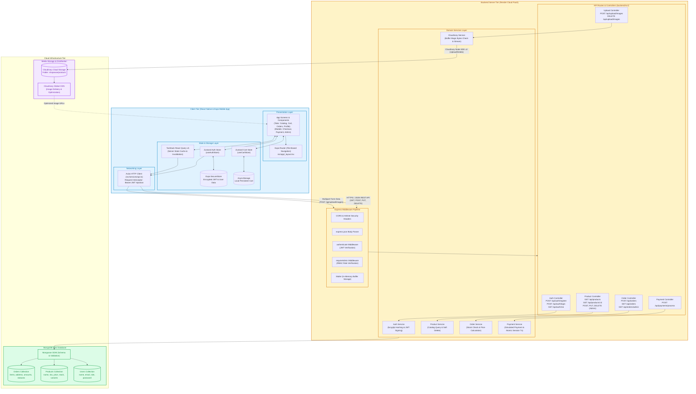

# ShopEase Application Architecture Diagram

This document illustrates the end-to-end architecture of the ShopEase mobile e-commerce platform, covering the React Native client, state management, networking, Express application server, and cloud infrastructure.

---

## 1. System Architecture Diagram

---

## 2. Architecture Layer Descriptions

### 1. Presentation & Routing Layer
- **Framework**: React Native with Expo SDK 54, styled via NativeWind / Tailwind CSS.
- **Routing**: Expo Router using file-based navigation conventions (`src/app/`). Tab navigators handle primary customer views (Catalog, Cart, Orders, Profile), and stacked modals handle checkout, payment simulation, product details, and the administrator suite.

### 2. State & Storage Architecture
- **Offline Cart Persistence**: The shopping cart is managed client-side via **Zustand** (`useCartStore`) and persisted locally using **AsyncStorage**. Cart operations require zero network latency, and items are preserved offline and during payment failures.
- **Secure Authentication**: Authentication tokens (JWT) and user identity profiles are stored securely in hardware-backed storage via **Expo SecureStore** (`auth_token`, `auth_user`).
- **Server Cache & Synchronization**: Catalog listings and order records are fetched and cached using **TanStack React Query v5**, providing automatic background refetching and stale-time caching.

### 3. Networking Layer
- **Axios HTTP Client**: Centralized Axios client (`src/services/api.ts`) configured with `EXPO_PUBLIC_API_URL`.
- **JWT Interceptor**: An asynchronous request interceptor retrieves the JWT token from `SecureStore` and automatically injects the `Authorization: Bearer <token>` header for all authenticated requests.

### 4. Express Server & Middleware Pipeline
- **Hosting**: Live cloud deployment on **Render PaaS** with auto-deploy from GitHub.
- **Security Middleware**: `cors` restricts origins, `helmet` applies defense-in-depth HTTP security headers, and `express.json()` parses payloads.
- **Access Control**:
  - `authenticate`: Extracts Bearer token, validates JWT signature against `JWT_SECRET`, and attaches `req.user.userId`.
  - `requireAdmin`: Queries the database to verify `user.role === "admin"`. Non-admin accounts receive `403 Forbidden`.
- **Media Upload**: Uses `multer` with memory storage to validate image buffers and avoid temporary disk storage on ephemeral container instances.

### 5. Services & Business Logic Layer
- **Atomic Checkout & Inventory**: The `order.service.ts` verifies product stock limits, enforces variant selection, and applies fixed `₹40` delivery fees.
- **Simulated Payment Lifecycle**: The `payment.service.ts` simulates payment outcome (`SUCCESS` vs. `FAILED`). Upon `SUCCESS`, it opens an atomic MongoDB session transaction (`session.withTransaction`) to decrement stock (`$inc: { stock: -quantity }`) and confirm the order. Upon `FAILED`, stock is untouched and the cart remains intact on the mobile device.
- **Cloudinary Integration**: Cloudinary SDK v2 streams validated image buffers directly to the `shopease/products` cloud directory. An active-reference guard prevents deleting images currently associated with live products.

### 6. Data & Cloud Storage Layer
- **Primary Database**: **MongoDB Atlas** managed via **Mongoose ODM**. Schema definitions include validation, indexes, and timestamps.
- **Image CDN**: **Cloudinary** provides global CDN caching, responsive format conversion (WebP/AVIF), and optimized delivery directly to mobile `ProductImage` components.
