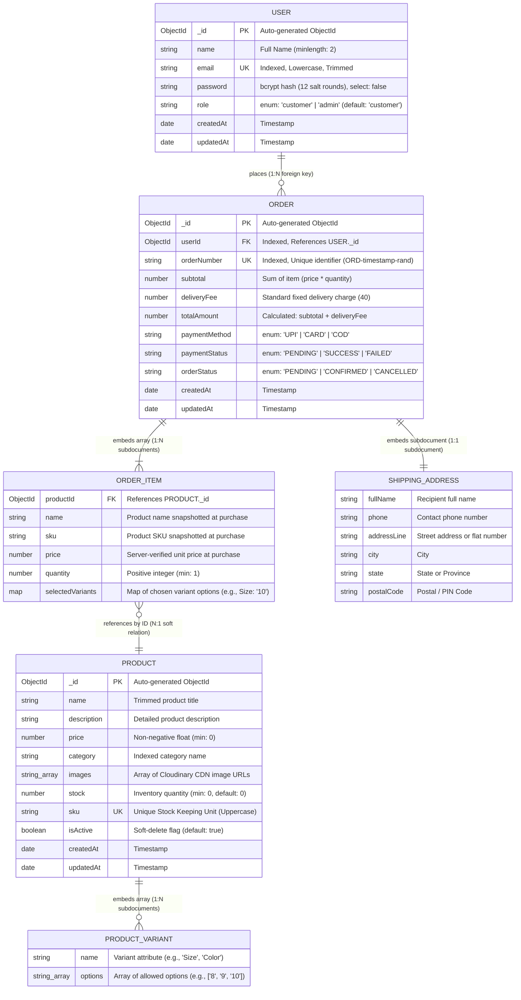
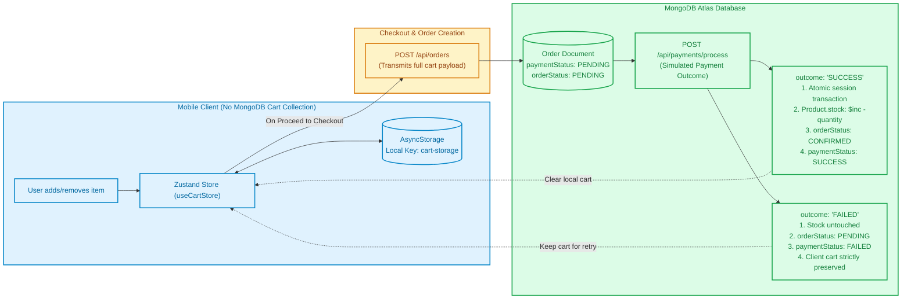

# ShopEase Database Schema & Entity Relationship Specification

This document specifies the MongoDB database schema for ShopEase, implemented using Mongoose ODM in `backend/src/models/`. It details the collections, embedded subdocuments, foreign key references, and indexes, highlighting the boundary between client-managed state and server database persistence.

---

## 1. Entity Relationship Diagram (ERD)

---

## 2. Cart Architecture & Client vs. Server Boundary

A fundamental architectural principle of ShopEase is the distinction between **ephemeral client state** and **durable server persistence**:

---

## 3. Schema Details & Architectural Rationale

### A. User Collection (`backend/src/models/user.model.ts`)
- **Collection Name**: `users`
- **Authentication Credentials**: Passwords are encrypted with `bcryptjs` using 12 salt rounds before insertion. The schema enforces `select: false` so user queries omit password hashes by default.
- **Roles**: Strictly typed enum: `"customer"` (default for self-registered users) and `"admin"` (assigned via administrator promotion).

### B. Product Collection (`backend/src/models/product.model.ts`)
- **Collection Name**: `products`
- **Soft Deletion**: Includes an `isActive` boolean flag (defaults to `true`). Admin deletion marks `isActive: false`, excluding products from customer queries while preserving historic integrity for past order receipts.
- **Indexes**:
  - `sku`: Unique sparse index (`{ unique: true }`).
  - `category`: B-tree index for fast catalog filtering.
- **Embedded Variants**: Variants (`Size`, `Color`, `Finish`, etc.) are embedded directly inside the product document as `{ name: string, options: string[] }[]`.

### C. Order Collection (`backend/src/models/order.model.ts`)
- **Collection Name**: `orders`
- **Referenced Relations**:
  - `userId`: `Schema.Types.ObjectId` referencing `User` (`ref: "User"`). Used for customer data isolation and populated in administrator order feeds.
- **Embedded Subdocuments**:
  - `items` (`OrderItem[]`): Each line item stores `productId` alongside historical snapshots of `name`, `sku`, `price`, and `selectedVariants`. This ensures changes to the live product catalog never alter historic financial receipts.
  - `shippingAddress` (`ShippingAddress`): Embedded directly inside the order to preserve delivery destination details at the time of purchase.
- **Financial Immutability**:
  - `subtotal`: Computed on the server by summing `price * quantity` from database product records.
  - `deliveryFee`: Fixed `₹40` shipping fee.
  - `totalAmount`: Enforced as `subtotal + deliveryFee`.

### D. Simulated Payment Lifecycle
- **No Third-Party Gateway Dependencies**: Payment processing is simulated via `POST /api/payments/process` using an explicit outcome parameter (`SUCCESS` vs. `FAILED`).
- **Atomic Stock Deduction**: Stock deduction occurs inside a MongoDB session transaction (`session.withTransaction`) only when payment succeeds. If payment fails, product stock is not decremented, and the order remains `PENDING` so the user can re-attempt payment with the same items.
